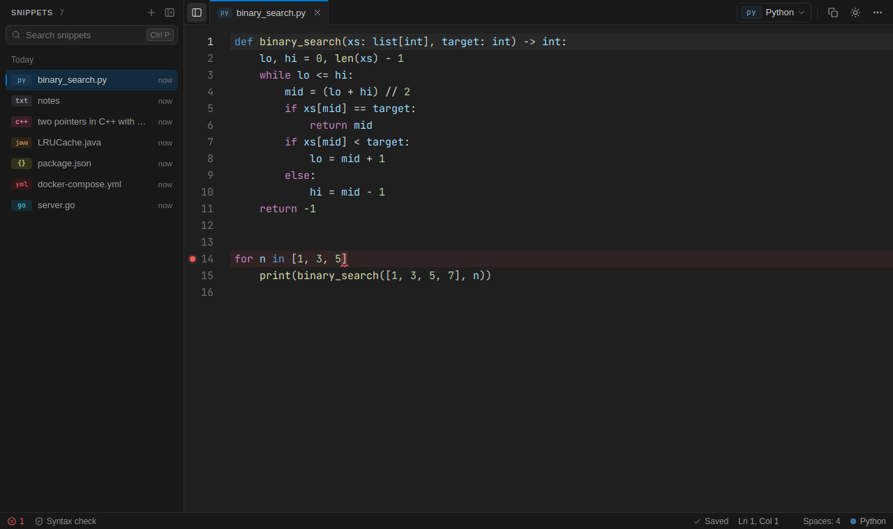

# Snippet Editor

A small code editor that runs in your browser, for when you want to show or explain a piece of code without opening your full IDE.

It highlights code, underlines syntax errors as you type, and keeps your snippets. It doesn't run anything.



## Why

Opening VS Code just to explain a snippet means disturbing whatever project it's busy with. Online playgrounds forget your code and are packed with features you don't need. This sits in a browser tab, starts instantly, and remembers everything.

## Features

- **Syntax highlighting** for 23 common languages.
- **Live syntax errors** for Python, JSON, Go, YAML, Java, C++ and more. Errors get a red underline; hover one to see what's wrong.
- **Snippets are saved automatically** on your machine and survive restarts.
- **Tabs:** open several snippets and drag tabs to reorder. Each tab keeps its cursor and undo history.
- **Light and dark themes**, a layout like VS Code, and keyboard shortcuts.
- **Small:** one ~10 MB Docker container, and nothing else to install.

## Run it

You only need [Docker](https://www.docker.com/).

```sh
git clone https://github.com/shubham-chemate/in-browser-editor.git
cd in-browser-editor
docker compose up -d --build
```

Open **http://code-editor.localhost**. In Chrome, after the first visit, typing `code-editor` is enough. `http://localhost:8080` works too.

It's only reachable from your own machine. Stop it with `docker compose down`; your snippets are kept.

## Handy shortcuts

| | |
|---|---|
| New snippet | `Alt+N` |
| Find a snippet | `Ctrl/Cmd+P` |
| Rename | Double-click the tab, or `F2` |
| Change language | Click the language button, or `Ctrl/Cmd+K` then `M` |
| Jump to next error | `F8` |
| Toggle sidebar | `Ctrl/Cmd+B` |

Tip: name a snippet like a file (`main.go`, `config.yaml`) and the language switches automatically.

## How it works

- **Frontend:** [CodeMirror 6](https://codemirror.net), Vite and TypeScript, with no UI framework. Syntax errors come from the same parsers that do the highlighting, so any language with a full parser gets error checking for free.
- **Backend:** a tiny Go server that serves the app and stores each snippet as a JSON file on a Docker volume.

More detail is in [`docs/ui-plan.md`](docs/ui-plan.md), the UI design spec.

## Development

Everything runs in Docker; nothing is installed on your machine.

```sh
docker compose --profile dev up        # live-reload UI at http://localhost:5173
docker build --target web-test .       # frontend unit tests
docker build --target server-test .    # Go tests
./e2e/run.sh                           # end-to-end browser test
```

## Limitations

- It catches **syntax** errors, not type errors or undefined names. Those would need a language server per language, which is a possible next step.
- Languages without a full parser (Ruby, Kotlin, Shell, …) are highlight-only.
